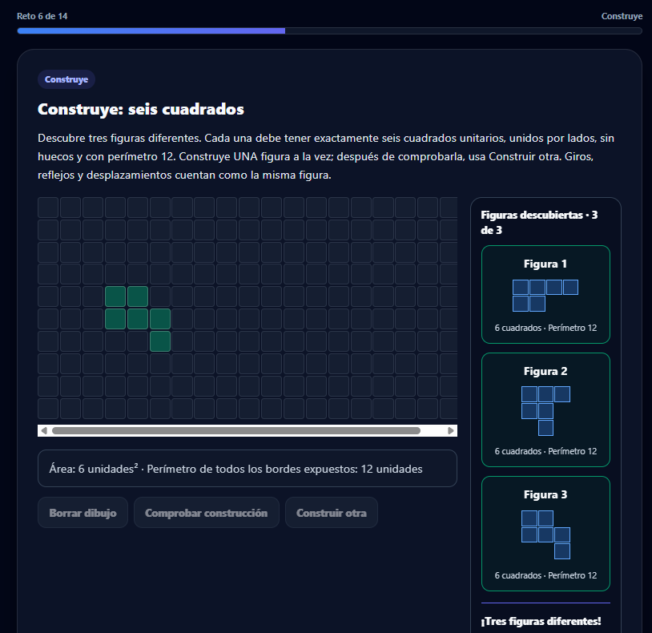

  

  
  
  
  

  
  

# Misión Olimpia

> **Educational software · Product development case study.** Plataforma interactiva para fortalecer el razonamiento matemático en educación primaria mediante desafíos, simulacros y experiencias de gamificación.

**Estado actual:** prototipo funcional para uso local. **Disponibilidad:** portafolio documental; el código fuente no se publica.

Misión Olimpia fue desarrollada para apoyar tutorías matemáticas individuales mediante una experiencia interactiva que combina geometría, razonamiento, evaluación y actividades recreativas. Su diseño prioriza la continuidad de las sesiones y la ejecución sin conexión.

**Qué demuestra este proyecto:** desarrollo de interfaces educativas, reglas de validación, persistencia y recuperación de sesiones, gamificación y pruebas automatizadas.

---

## Vista general

| Característica | Estado |
| --- | --- |
| Actividades interactivas de geometría y razonamiento | Implementadas en el prototipo |
| Simulacro de opción múltiple | Implementado |
| Gamificación: NIMO Stars y NIMO Brick Rush | Implementada |
| Guardado local y recuperación de sesiones | Implementados |
| Importación y exportación de datos | Implementadas |
| Ejecución local sin conexión (`file://`) | Verificada durante el desarrollo |
| Pruebas automatizadas | 80 pruebas aprobadas en el último cierre reportado |
| Plataforma multiusuario en línea | Propuesta; no implementada |

## Galería del prototipo

Las siguientes son **capturas reales** de la aplicación, incorporadas sin publicar el código fuente ni los datos de sesiones individuales.

### 1. Bienvenida y acceso a los retos

Pantalla de inicio con identidad visual propia, instrucciones de participación y acceso a los desafíos matemáticos.

### 2. Construcción interactiva de figuras

Actividad de geometría que permite construir figuras en una cuadrícula, comprobar restricciones y explorar diferentes soluciones equivalentes mediante giros, reflexiones y desplazamientos.

### 3. Pausa lúdica: NIMO y las estrellas fugaces

Experiencia recreativa entre actividades, diseñada sin vidas, castigos ni puntuación competitiva.

### 4. NIMO Brick Rush

Actividad gamificada complementaria, independiente de la calificación del simulacro, con opciones para pausar, reanudar o reiniciar la partida.

> **Nota:** estas imágenes documentan pantallas específicas del prototipo; no representan un producto multiusuario desplegado públicamente. Las capturas de un panel de instructor y de vista móvil podrán añadirse más adelante, tras su revisión de privacidad.

## Tecnologías utilizadas actualmente

- **Frontend:** HTML5, CSS3 y JavaScript.
- **Persistencia:** almacenamiento local del navegador, con mecanismos de recuperación y transferencia de datos.
- **Ejecución:** aplicación web local, sin servidor obligatorio y sin dependencia de internet para las actividades incluidas.
- **Calidad:** pruebas automatizadas de JavaScript ejecutadas con Node.js.
- **Control de versiones:** Git, con desarrollo incremental documentado.

## Arquitectura propuesta para una futura versión pública

Las siguientes tecnologías son **opciones de diseño bajo evaluación**, no componentes ya implementados:

- **React + TypeScript** para una interfaz modular y mantenible.
- **Node.js + NestJS** para una API y servicios de aplicación, si el modelo multiusuario lo requiere.
- **PostgreSQL** para persistencia centralizada.
- **PWA y estrategias offline-first** para conservar parte de la experiencia sin conexión.
- **Autenticación y roles** para instructores y estudiantes, con especial atención a la privacidad de menores.
- **Analítica pedagógica e IA asistida**, sujetas a validación educativa y salvaguardas de datos.

La selección definitiva dependerá de pruebas de uso, alcance del MVP, costos de operación y requisitos de privacidad.

## Decisiones de ingeniería

1. **Offline-first:** facilitar actividades sin depender de una conexión estable.
2. **Persistencia recuperable:** reducir el riesgo de perder avances ante cierres o recargas.
3. **Separación entre evaluación y gamificación:** mantener claros los objetivos pedagógicos.
4. **Pruebas automatizadas:** verificar reglas, almacenamiento y comportamientos críticos.
5. **Privacidad desde el diseño:** excluir datos reales de estudiantes del material de demostración.

## Evolución del producto

| Fase | Objetivo | Estado |
| --- | --- | --- |
| 1. Prototipo local | Actividades, simulacro, juegos, persistencia y pruebas | Funcional |
| 2. MVP público | Validar usuarios, experiencia, accesibilidad y arquitectura | Planeado |
| 3. Gestión educativa | Grupos, contenidos, seguimiento y reportes | Propuesto |
| 4. Asistencia inteligente | Recomendaciones y adaptación de ejercicios con supervisión | Exploratorio |

Consulta [la hoja de ruta](docs/roadmap.md) y [la arquitectura](docs/arquitectura.md) para conocer las decisiones pendientes.

## Privacidad y disponibilidad

Este repositorio contiene exclusivamente documentación del producto. El código de la aplicación, las preguntas utilizadas en tutorías, las evaluaciones individuales y los archivos de referencia se mantienen fuera de esta publicación. Las futuras capturas deberán usar datos ficticios y revisarse antes de incorporarse.

**El código fuente no está disponible públicamente en esta etapa.** Esta publicación no concede licencia sobre el software original ni sobre contenidos de terceros.

---

*Proyecto presentado como evidencia de desarrollo de producto, experiencia de usuario, pruebas y diseño de software educativo.*
